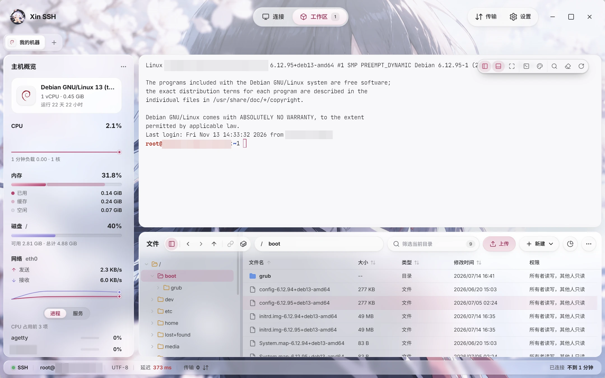
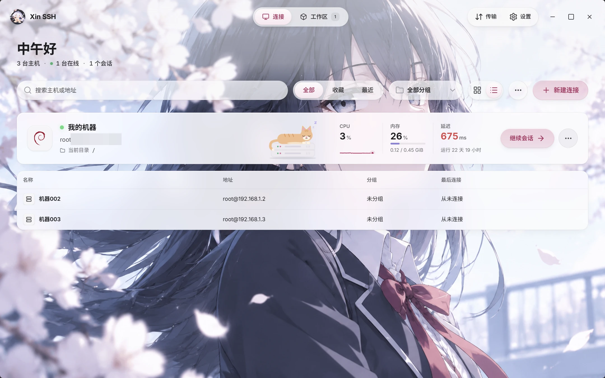
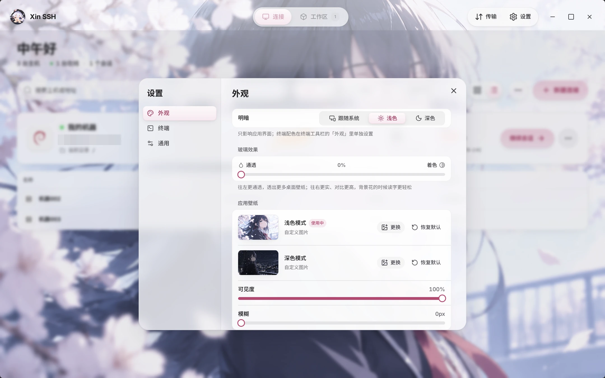

<div align="center">


# Xin SSH

Manage a remote server the way you manage files on your own computer.

[简体中文](README.md) · **English**


</div>

<picture>
  <source media="(prefers-color-scheme: dark)" srcset=".github/assets/screenshots/workspace-dark.webp" />
  
</picture>

## What it is

Xin SSH is an SSH client that puts the terminal, file management and server monitoring in one window.

It makes file management the main event: drag, double-click and right-click files on the server just like on your own machine. The terminal sits right next to them, and the two work together.

- **Hands off your server**: no agent, no edits to `.bashrc`, no injected scripts. Everything runs on the client
- **Lightweight**: built on Tauri 2 with the system WebView, so it doesn't ship a copy of Chromium
- **Early days**: still at 0.1.x, developed and tested mainly on Windows 11

Yes, the icon is a cat-eared girl. No, this does not affect her ability to connect to servers.

## Features

### Files

- Path bar, back and forward, multi-select, context menus. Folders with tens of thousands of entries stay smooth
- Drag to upload, whole folders included. Name clashes ask whether to overwrite, skip or rename
- Pause and resume transfers. Every finished transfer is checked with SHA-256
- Double-click a file to edit it in the built-in editor. Save, and it's written straight back to the server
- **Ctrl + V** saves the file, screenshot or text on your clipboard straight to the server
- Compress and extract on the server (zip, tar.gz) from the context menu, without a round trip through your machine
- Disk usage analysis shows which folder is filling up the disk
- Change permissions with checkboxes, with a plain-language description of what they mean
- Browse files inside Docker containers (read-only) and read container logs, stopped containers included

### Terminal

- `cd` in the terminal, and the file panel follows
- Ctrl / ⌘ + click a path in the terminal: files open in the editor at that exact line, folders open in the file panel
- Click a port the server prints (say, `listening on :8080`) and it's forwarded to your machine and opened in your browser
- Drag a file onto the terminal and its path lands on the command line. Drag one from your desktop and it's uploaded to the terminal's current directory first
- **Suggestions**: matching commands from your history appear in grey as you type. Press → to accept
- **Command marks**: prompts are coloured, commands that run longer than 3 seconds show their duration on the right, and Ctrl + ↑ / ↓ jumps between commands
- **Snippets**: save the commands you use all the time and send them with one click
- **Production guard**: mark a connection as production, and `rm -rf`, `drop database` or a multi-line paste ask for confirmation before Enter goes through
- Multiple terminals per connection, automatic reconnect, and your tabs come back when you reopen the app

### Monitoring

- A host overview in the sidebar: system info, CPU history, memory (used / cache / free), disk, network speed, top processes and services
- The "resume session" card on the home page shows live CPU, memory and latency. A cat naps on it, and wakes up when the server gets busy (CPU or memory at 80%)

### Connections and security

- Auth: password, private key (ed25519 / RSA / ECDSA, passphrases supported), your local SSH agent, and keyboard-interactive / 2FA
- Host fingerprints are recorded on first connect. If one changes later, the connection is refused
- Saved passwords and keys are encrypted with ChaCha20-Poly1305 and never leave your computer
- Groups, favourites, recents and drag-to-reorder, with distro icons detected automatically
- Import from `~/.ssh/config` (hosts behind a jump host are skipped for now), export your connections
- SSH tunnels (local port forwarding)
- Unsaved files or running transfers get a confirmation before the window closes

### Looks

- An iOS-style liquid glass interface, in light and dark
- Light and dark wallpapers built in, or use your own. The glass transparency is adjustable
- Terminal themes: our own Ink & Rose (dark) and Ink & Rose Day (light), plus Catppuccin, Tokyo Night, Rosé Pine, Gruvbox Material, Nord, Vesper, Dracula and Poimandres
- Seven monospace fonts, with WebGL terminal rendering
- English / 中文

## Screenshots

The screenshots follow your GitHub light or dark theme.

**Home**: all your connections, with the active session up top

<picture>
  <source media="(prefers-color-scheme: dark)" srcset=".github/assets/screenshots/home-dark.webp" />
  
</picture>

**Settings**: light and dark, glass and wallpapers

<picture>
  <source media="(prefers-color-scheme: dark)" srcset=".github/assets/screenshots/settings-dark.webp" />
  
</picture>

## Download

Grab the installer for your system from [Releases](https://github.com/ASAMUL/xin-ssh/releases/latest):

- **Windows**: `-setup.exe`
- **macOS**: `.dmg`, `aarch64` for Apple silicon and `x64` for Intel
- **Linux**: `AppImage`, `deb` or `rpm`

The macOS and Linux builds are experimental. If you try them, please tell us how it went in an issue.

The installers aren't code-signed yet, so on first launch:

- **Windows** may say "Windows protected your PC". Click "More info" → "Run anyway"
- **macOS** may claim the app is damaged. Run `xattr -cr "/Applications/Xin SSH.app"` in Terminal, then open it again

## Build from source

You'll need:

- Node.js and [pnpm](https://pnpm.io/)
- [Rust](https://www.rust-lang.org/tools/install) (stable)
- The Tauri 2 system dependencies, see the [Tauri docs](https://v2.tauri.app/start/prerequisites/)

```sh
pnpm install
pnpm tauri dev     # run in development mode
pnpm tauri build   # build the installer
pnpm test          # run the frontend unit tests
```

## Tech stack

| Part | What it uses |
| --- | --- |
| App shell | Tauri 2 |
| SSH / SFTP | Rust: russh, russh-sftp, tokio |
| UI | Vue 3, Nuxt UI 4, Tailwind CSS 4, Pinia, vue-i18n |
| Terminal | xterm.js 6 (WebGL renderer) |
| Editor | CodeMirror 6 |
| Animation | dotlottie-web |

## Contributing

Issues and pull requests are welcome.

Found a bug? Congratulations, it's our bug now. Both of ours.

## Acknowledgements

A lot of Xin SSH was pair-programmed with [Claude](https://claude.com/claude-code). Claude wrote this README, too.

[Linux.do](https://linux.do) A genuine, welcoming, cohesive, and professional Chinese-language community—a refreshing presence in the world of online forums.


Animated icons come from [lucide-motion-vue](https://github.com/respeak-io/lucide-motion-vue). The shapes are [Lucide](https://lucide.dev) (ISC); the motion is adapted from [lucide-animated](https://lucide-animated.com) (MIT) and [animate-ui](https://github.com/imskyleen/animate-ui) (MIT + Commons Clause).

The two cats on the empty state and the connection-failure screen come from [LottieFiles](https://lottiefiles.com). They're distributed under the Lottie Simple License, not the project's MIT license; see [src/assets/lottie/LICENSE.md](src/assets/lottie/LICENSE.md). The cat napping on the session card is our own.

## License

[MIT](LICENSE)
