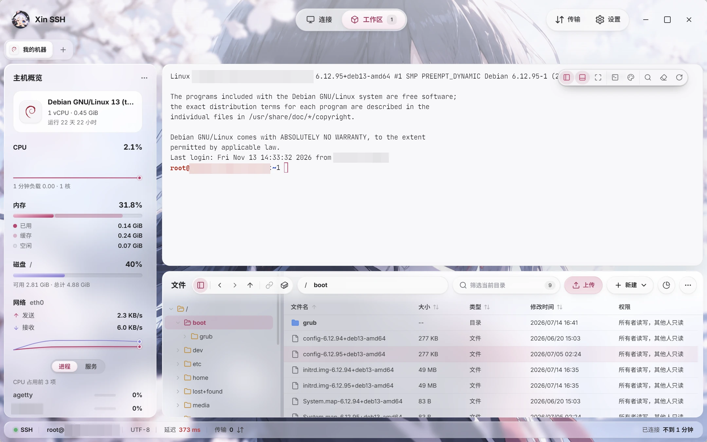
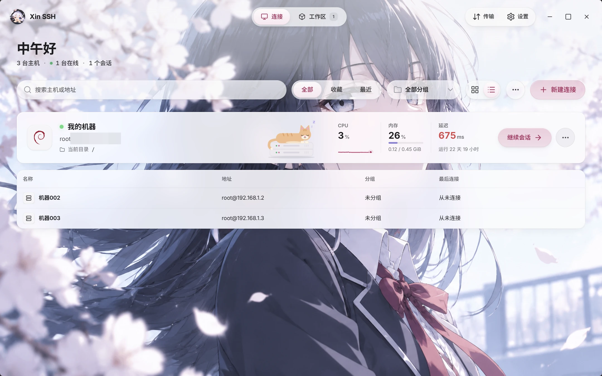
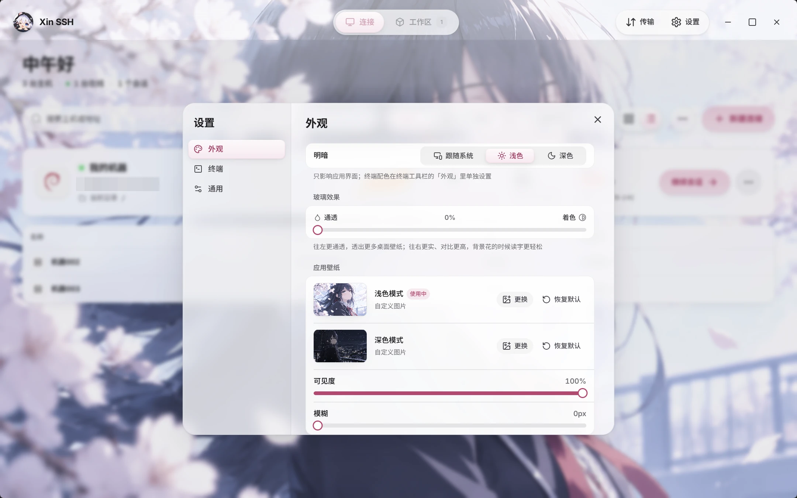

<div align="center">


# Xin SSH

像本地资源管理器一样操作远程服务器。

**简体中文** · [English](README.en.md)


</div>

<picture>
  <source media="(prefers-color-scheme: dark)" srcset=".github/assets/screenshots/workspace-dark.webp" />
  
</picture>

## 简介

Xin SSH 是一个 SSH 客户端，把终端、文件管理和主机监控放在同一个窗口里。

它让文件管理当主角：服务器上的文件，你可以像在自己电脑上一样拖拽、双击、右键。终端就在旁边，两边还会互相配合。

- **不碰你的服务器**：不装 agent，不改 `.bashrc`，不注入脚本，所有功能都在客户端完成
- **轻**：基于 Tauri 2，用系统自带的 WebView，不额外打包一个 Chromium
- **还在早期**：当前版本 0.1.0，主要在 Windows 11 上开发和测试

是的，图标是一个猫耳少女。不，这不影响它连服务器。

## 功能

### 文件管理

- 路径栏、前进后退、多选、右键菜单；几万个文件的目录也不卡
- 拖拽上传，整个文件夹也行；同名文件会问你覆盖、跳过还是改名
- 传输可以暂停、断点续传，传完用 SHA-256 核对
- 双击文件在内置编辑器里打开，保存直接写回服务器
- **Ctrl + V** 把剪贴板里的文件、截图或文字直接存到服务器
- 右键在服务器上压缩、解压（zip、tar.gz），不用下载下来再传回去
- 目录占用分析：一眼看出是哪个目录把磁盘塞满了
- 权限用勾选框改，还会用大白话告诉你这组权限是什么意思
- 浏览 Docker 容器里的文件（只读）、查看容器日志，已经停止的容器也能看日志

### 终端

- 终端里 `cd` 到哪，文件面板就跟到哪
- 按住 Ctrl / ⌘ 点终端里的路径：文件在编辑器里打开并跳到那一行，目录在文件面板里打开
- 点一下服务器打印的端口（比如 `listening on :8080`），自动转发到本机并在浏览器里打开
- 文件拖进终端自动填上路径；从桌面拖进来，先上传到终端当前目录再填路径
- **命令联想**：打字时用灰字补出历史里匹配的命令，按 → 采纳
- **命令标记**：提示符自动上色，跑了 3 秒以上的命令在右侧显示耗时，Ctrl + ↑ / ↓ 在命令之间跳
- **命令片段**：常用命令存起来，点一下就发
- **生产机保护**：给连接打开「生产环境」，之后敲 `rm -rf`、`drop database`，或者粘贴多行命令，回车前都会先让你确认
- 同一个连接可以开多个终端，断线自动重连，重新打开应用时恢复上次的标签页

### 主机监控

- 侧栏主机概览：系统信息、CPU 走势、内存（已用 / 缓存 / 空闲）、磁盘、网速、占用最高的进程和服务
- 首页的「继续会话」卡片实时显示 CPU、内存和延迟。卡片上趴着一只打盹的猫，服务器忙起来（CPU 或内存到 80%）它就醒了

### 连接与安全

- 认证方式：密码、私钥（ed25519 / RSA / ECDSA，支持口令）、本机 SSH agent、keyboard-interactive 二次验证
- 首次连接记下主机指纹，之后指纹对不上就拒绝连接
- 保存的密码和私钥用 ChaCha20-Poly1305 加密，只存在你自己的电脑上
- 连接分组、收藏、最近使用、拖拽排序，自动识别服务器发行版并配上图标
- 导入 `~/.ssh/config`（要经跳板机的主机暂时会跳过），导出连接配置
- SSH 隧道（本地端口转发）
- 还有没保存的文件或正在传的任务时，关窗前会先问你

### 外观

- iOS 风格的液态玻璃界面，深色、浅色两套
- 自带深浅两张壁纸，也能换成自己的；玻璃的通透程度可以调
- 终端主题：自家的墨樱（深色）和墨樱 · 昼（浅色），以及 Catppuccin、Tokyo Night、Rosé Pine、Gruvbox Material、Nord、Vesper、Dracula、Poimandres
- 七款等宽字体可选，终端用 WebGL 渲染
- 中文 / English

## 截图

截图会跟着你的 GitHub 深浅色主题切换。

**首页**：所有连接一览，正在进行的会话放在最上面

<picture>
  <source media="(prefers-color-scheme: dark)" srcset=".github/assets/screenshots/home-dark.webp" />
  
</picture>

**设置**：深浅色、玻璃效果和壁纸

<picture>
  <source media="(prefers-color-scheme: dark)" srcset=".github/assets/screenshots/settings-dark.webp" />
  
</picture>

## 下载

去 [Releases](https://github.com/ASAMUL/xin-ssh/releases/latest) 下载对应系统的安装包：

- **Windows**：`-setup.exe`
- **macOS**：`.dmg`，Apple 芯片选 `aarch64`，Intel 选 `x64`
- **Linux**：`AppImage`、`deb` 或 `rpm`

macOS 和 Linux 版是实验性的，欢迎在 issue 里告诉我们实际情况。

安装包暂时没有数字签名，第一次打开时：

- **Windows** 可能弹出「Windows 已保护你的电脑」，点「更多信息」→「仍要运行」
- **macOS** 如果提示「已损坏，无法打开」，在终端里运行 `xattr -cr "/Applications/Xin SSH.app"` 再打开

## 从源码运行

需要先装好：

- Node.js 和 [pnpm](https://pnpm.io/)
- [Rust](https://www.rust-lang.org/tools/install)（stable）
- Tauri 2 的系统依赖，见 [Tauri 官方文档](https://v2.tauri.app/start/prerequisites/)

```sh
pnpm install
pnpm tauri dev     # 开发模式
pnpm tauri build   # 打包安装程序
pnpm test          # 跑前端单元测试
```

## 技术栈

| 部分 | 用了什么 |
| --- | --- |
| 应用外壳 | Tauri 2 |
| SSH / SFTP | Rust：russh、russh-sftp、tokio |
| 界面 | Vue 3、Nuxt UI 4、Tailwind CSS 4、Pinia、vue-i18n |
| 终端 | xterm.js 6（WebGL 渲染） |
| 编辑器 | CodeMirror 6 |
| 动画 | dotlottie-web |

## 参与贡献

欢迎提 issue 和 PR。

如果你发现了 bug：恭喜，它现在是我们共同的 bug 了。

## 致谢

Xin SSH 的很多代码，是和 [Claude](https://claude.com/claude-code) 结对写出来的。这份 README 也是它写的。

动态图标来自 [lucide-motion-vue](https://github.com/respeak-io/lucide-motion-vue)。图形是 [Lucide](https://lucide.dev)（ISC），动效改编自 [lucide-animated](https://lucide-animated.com)（MIT）和 [animate-ui](https://github.com/imskyleen/animate-ui)（MIT + Commons Clause）。

空状态和连接失败时的两只猫来自 [LottieFiles](https://lottiefiles.com)，按 Lottie Simple License 分发，不在本项目的 MIT 许可范围内，详见 [src/assets/lottie/LICENSE.md](src/assets/lottie/LICENSE.md)。会话卡片上打盹的那只是我们自己画的。

## 许可证

[MIT](LICENSE)
